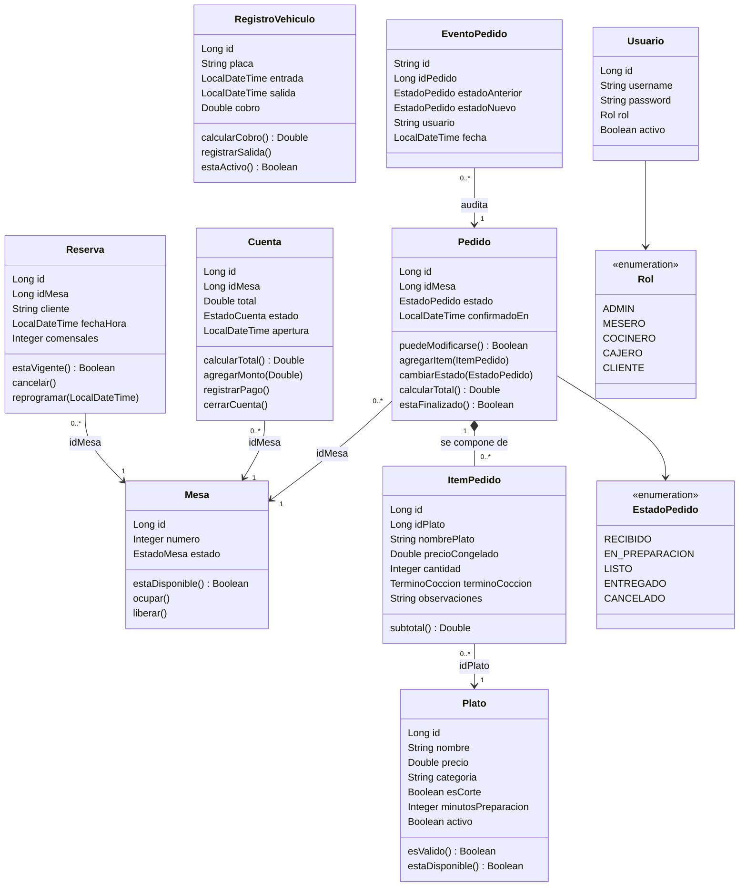
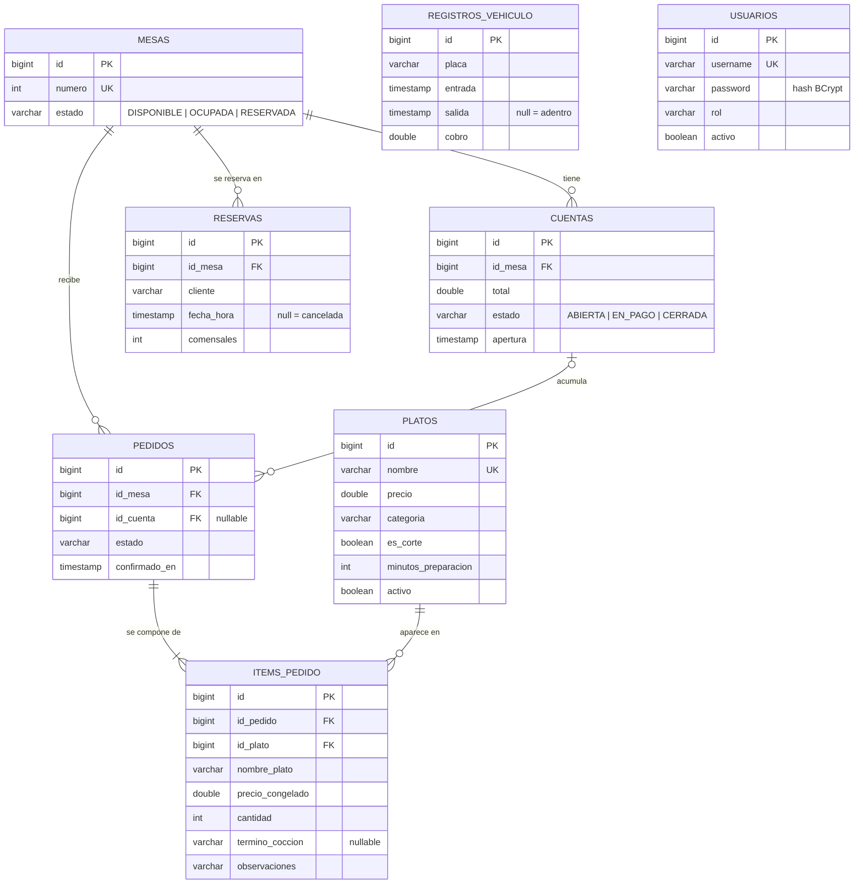
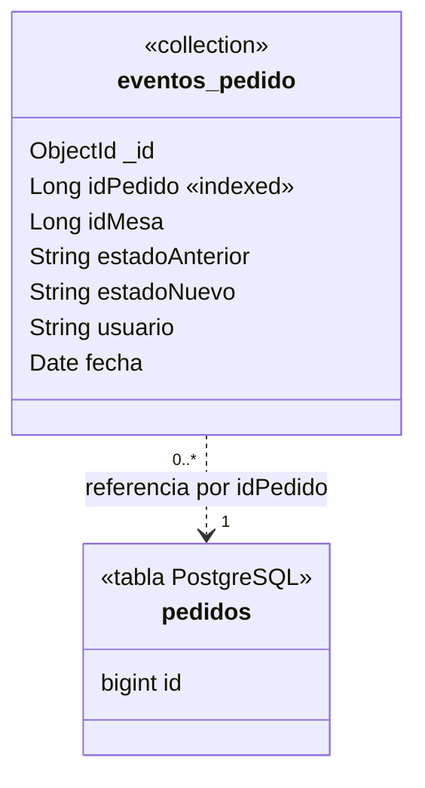
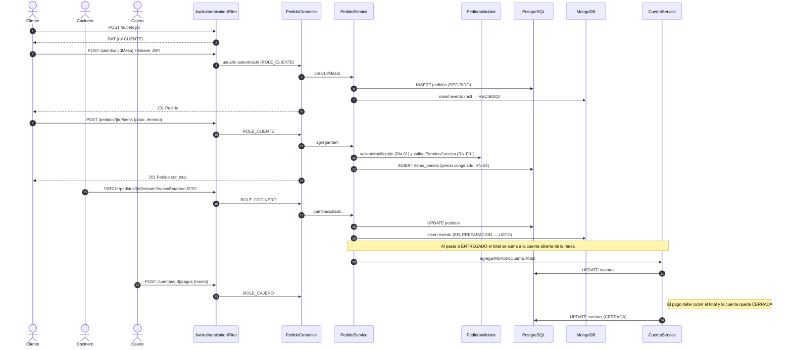
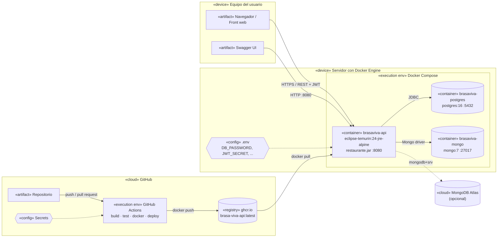
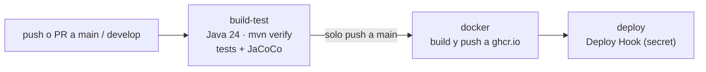
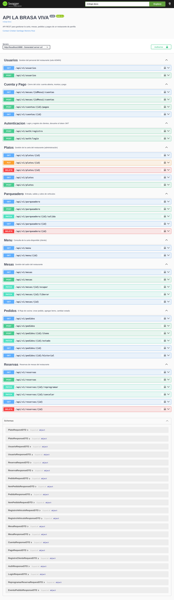

# LA BRASA VIVA · API REST

**LA BRASA VIVA** es una plataforma web que digitaliza la operación de un restaurante de parrilla: consulta de la carta, armado y confirmación del pedido, preparación en cocina, cierre de la cuenta con su pago, reservas de mesas y parqueadero.

**Autor:** Cristian Santiago Moreno Ruiz · Escuela Colombiana de Ingeniería · DOSW 1 · Corte 2

---

## Índice

1. [Tecnologías](#1-tecnologías)
2. [Arquitectura y estructura del proyecto](#2-arquitectura-y-estructura-del-proyecto)
3. [Cómo ejecutar el proyecto](#3-cómo-ejecutar-el-proyecto)
4. [Persistencia: relacional y no relacional](#4-persistencia-relacional-y-no-relacional)
5. [Seguridad: JWT y roles](#5-seguridad-jwt-y-roles)
6. [Endpoints](#6-endpoints)
7. [Diagramas](#7-diagramas)
   - [7.1 Diagrama de clases del dominio](#71-diagrama-de-clases-del-dominio)
   - [7.2 Diagrama entidad-relación (PostgreSQL)](#72-diagrama-entidad-relación-postgresql)
   - [7.3 Diagrama de documentos (MongoDB)](#73-diagrama-de-documentos-mongodb)
   - [7.4 Diagrama de secuencia: del pedido al pago](#74-diagrama-de-secuencia-del-pedido-al-pago)
   - [7.5 Diagrama de despliegue](#75-diagrama-de-despliegue)
8. [Docker y CI/CD](#8-docker-y-cicd)
9. [Pruebas](#9-pruebas)
10. [Swagger](#10-swagger)

---

## 1. Tecnologías

| Capa | Tecnología |
|---|---|
| Lenguaje | Java 24 |
| Framework | Spring Boot 4.1 (Web MVC, Validation, Data JPA, Data MongoDB, Security) |
| Base de datos relacional | PostgreSQL 16 |
| Base de datos no relacional | MongoDB 7 (local o MongoDB Atlas) |
| Seguridad | Spring Security + JWT (jjwt) + BCrypt |
| Mapeo de objetos | MapStruct + Lombok |
| Documentación | springdoc-openapi (Swagger UI) |
| Pruebas | JUnit 5, Mockito, MockMvc, H2, JaCoCo |
| Contenedores | Docker + Docker Compose |
| CI/CD | GitHub Actions + GitHub Container Registry |

## 2. Arquitectura y estructura del proyecto

Arquitectura en capas: `Controller` → `Service` → `Repository`. El dominio no conoce la base de datos: los **mappers** traducen en tres direcciones.

```
RequestDTO ──(Mapper)──▶ Dominio ──(PersistenceMapper)──▶ Entity (JPA) / Document (Mongo)
ResponseDTO ◀──(Mapper)── Dominio ◀──(PersistenceMapper)── Entity (JPA) / Document (Mongo)
```

```
src/main/java/com/restaurante
├── config/                 SecurityConfig, CorsConfig, SwaggerConfig, AdminInicialConfig
├── controller/             Controladores REST + GlobalExceptionHandler
├── exception/              Excepciones de negocio
├── mapper/                 MapStruct: DTO ⇄ dominio y dominio ⇄ entidad/documento
├── model/
│   ├── domain/             Clases de negocio (Plato, Mesa, Cuenta, Pedido, ...)
│   └── dto/                request/ y response/
├── persistence/
│   ├── entity/             Entidades JPA (tablas de PostgreSQL)
│   └── document/           Documentos de MongoDB
├── repository/             JpaRepository y MongoRepository (uno por entidad/documento)
├── security/               JwtService, JwtAuthenticationFilter, UsuarioDetailsService
├── service/                Interfaces + implementaciones con la lógica de negocio
└── validator/              Validaciones de negocio que consultan el repositorio
```

**Reglas de negocio implementadas**

| Regla | Descripción | Dónde |
|---|---|---|
| RN-01 | Solo se agregan ítems a un pedido en estado `RECIBIDO` | `PedidoValidator.validarModificable` |
| RN-02 | El pedido avanza por estados; `ENTREGADO` y `CANCELADO` son finales | `PedidoServiceImpl.cambiarEstado` |
| RN-03 | Una mesa solo puede tener una cuenta abierta | `CuentaValidator.validarMesaSinCuentaAbierta` |
| RN-04 | El precio del plato se congela en el ítem al momento de pedirlo | `PedidoServiceImpl.agregarItem` |
| RN-P01 | Todo corte de carne debe registrar su término de cocción | `PedidoValidator.validarTerminoCoccion` |
| Pago | El pago debe cubrir el total de la cuenta; al pagar la cuenta se cierra | `CuentaValidator.validarMontoCubreTotal` |
| Cuenta | Al entregar un pedido, su total se suma a la cuenta abierta de la mesa | `PedidoServiceImpl.cargarACuentaDeLaMesa` |
| Únicos | No se repiten nombres de plato, números de mesa, usuarios ni placas dentro del parqueadero | `validator/` |

## 3. Cómo ejecutar el proyecto

### Opción A: todo con Docker (recomendada)

```bash
cp .env.example .env      # y poner claves propias en .env
docker compose up --build
```

Levanta PostgreSQL, MongoDB y la API. Swagger queda en <http://localhost:8080/swagger-ui/index.html>.

### Opción B: desde IntelliJ

1. **Project Structure → SDK: Java 24** (y *Language level* 24).
2. Tener PostgreSQL con la base `brasaviva` y MongoDB local (o una URI de Atlas).
3. En la configuración de ejecución agregar las variables de entorno:

| Variable | Obligatoria | Ejemplo / valor por defecto |
|---|---|---|
| `DB_PASSWORD` | Sí | clave del usuario de PostgreSQL |
| `DB_USER` | No | `brasa` |
| `DB_URL` | No | `jdbc:postgresql://localhost:5432/brasaviva` |
| `MONGODB_URI` | No | `mongodb://localhost:27017/brasaviva` o la URI de Atlas |
| `JWT_SECRET` | Sí | texto aleatorio de 32 caracteres o más |
| `ADMIN_USERNAME` / `ADMIN_PASSWORD` | Recomendado | crean el primer usuario `ADMIN` al arrancar |
| `JWT_EXPIRATION_MINUTES` | No | `60` |

> Las credenciales nunca se escriben en el código ni en `application.properties`: se leen de variables de entorno. El archivo `.env` está en `.gitignore`.

### Probar rápido en Swagger

1. `POST /api/v1/auth/login` con el admin inicial → copiar el `token`.
2. Botón **Authorize** → pegar el token.
3. Crear un plato, consultarlo y borrarlo; luego verificarlo en la base:

```sql
SELECT * FROM platos;
```

## 4. Persistencia: relacional y no relacional

El proyecto es **híbrido**: cada dato vive en el motor que mejor le sirve.

| Motor | Qué guarda | Por qué |
|---|---|---|
| **PostgreSQL** | Platos, mesas, cuentas, pedidos, ítems, reservas, parqueadero y usuarios | Datos estructurados con relaciones y transacciones ACID (un pago no puede quedar a medias) |
| **MongoDB** | `eventos_pedido`: auditoría de cada cambio de estado de un pedido | Muchos inserts, solo se agregan y se consultan por pedido; esquema flexible |

- **IDs:** `Long` con `@GeneratedValue(strategy = IDENTITY)` en PostgreSQL (tablas internas con muchas FK). En Mongo, `ObjectId` generado por la base (eventos con muchos inserts, ordenados por tiempo).
- **Relaciones JPA:** `@ManyToOne(fetch = LAZY)` y `@OneToMany(mappedBy, cascade)` entre pedido e ítems, sincronizadas en ambos sentidos con `PedidoEntity.agregarItem`.
- **Problema 1+N:** el listado de pedidos usa `JOIN FETCH` (`PedidoRepository.findAllConItems`).
- **Validadores:** consultan el repositorio (`existsByNombreIgnoreCase`, `existsByNumero`, ...) en vez de cargar la colección completa en memoria.
- **Auditoría tolerante a fallos:** si Mongo no responde, el pedido igual cambia de estado y el error queda en el log.

**Usar MongoDB Atlas:** crear el cluster, un usuario de base de datos y permitir la IP; luego poner la URI en `MONGODB_URI` (`mongodb+srv://<usuario>:<clave>@<cluster>.mongodb.net/brasaviva`).

## 5. Seguridad: JWT y roles

- **Autenticación:** `POST /api/v1/auth/login` valida usuario y contraseña (hash **BCrypt**) y devuelve un **JWT** firmado con HMAC-SHA. El token lleva el usuario (`sub`), el rol y su vencimiento.
- **Autorización:** `JwtAuthenticationFilter` valida la firma en cada petición y convierte el rol del token en `GrantedAuthority`. Las reglas por rol están en `SecurityConfig`.
- **API stateless:** sin sesión en el servidor, por eso CSRF está deshabilitado.
- **CORS:** solo los orígenes de `CORS_ALLOWED_ORIGINS` (por defecto `http://localhost:5173` y `http://localhost:3000`).
- **Errores:** `401` sin token o token inválido, `403` cuando el rol no tiene permiso; ambos con el mismo formato JSON del resto de la API.

| Rol | Quién es | Puede | No puede |
|---|---|---|---|
| `ADMIN` | Gerente | Todo: usuarios, carta, mesas y lo de los demás roles | — |
| `MESERO` | Atiende el salón | Mesas, abrir cuentas, crear pedidos, marcar entregado, reservas | Editar la carta, cobrar, crear usuarios |
| `COCINERO` | Cocina | Ver pedidos y cambiar su estado (en preparación, listo) | Crear pedidos, cuentas, reservas |
| `CAJERO` | Caja | Cuentas, registrar pagos, parqueadero | Cambiar estados de pedidos, editar la carta |
| `CLIENTE` | Comensal registrado | Ver menú, hacer pedidos, consultar su pedido, reservar | Cambiar estados, ver todos los pedidos |

La matriz completa endpoint por endpoint está en [`docs/roles-la-brasa-viva.xlsx`](docs/roles-la-brasa-viva.xlsx).

## 6. Endpoints

Base: `http://localhost:8080`

| Recurso | Método | Ruta | Roles |
|---|---|---|---|
| Autenticación | POST | `/api/v1/auth/login` | Público |
| | POST | `/api/v1/auth/registro` | Público (crea un `CLIENTE`) |
| Usuarios | GET, POST | `/api/v1/usuarios` | ADMIN |
| Menú | GET | `/api/v1/menu`, `/api/v1/menu/{id}` | Público |
| Platos | GET | `/api/v1/platos`, `/api/v1/platos/{id}` | ADMIN, MESERO, COCINERO |
| | POST, PUT, DELETE | `/api/v1/platos`, `/api/v1/platos/{id}` | ADMIN |
| Mesas | POST | `/api/v1/mesas` | ADMIN |
| | GET | `/api/v1/mesas`, `/api/v1/mesas/{id}` | ADMIN, MESERO, CAJERO |
| | PATCH | `/api/v1/mesas/{id}/ocupar`, `/api/v1/mesas/{id}/liberar` | ADMIN, MESERO |
| Cuentas | POST, GET | `/api/v1/mesas/{idMesa}/cuentas` | ADMIN, MESERO, CAJERO |
| | GET | `/api/v1/cuentas/{id}` | ADMIN, MESERO, CAJERO |
| | POST | `/api/v1/cuentas/{id}/pagos` | ADMIN, CAJERO |
| Pedidos | POST | `/api/v1/pedidos`, `/api/v1/pedidos/{id}/items` | ADMIN, MESERO, CLIENTE |
| | GET | `/api/v1/pedidos` | ADMIN, MESERO, COCINERO, CAJERO |
| | GET | `/api/v1/pedidos/{id}` | Todos los roles autenticados |
| | PATCH | `/api/v1/pedidos/{id}/estado?nuevoEstado=LISTO` | ADMIN, COCINERO, MESERO |
| | GET | `/api/v1/pedidos/{id}/historial` (MongoDB) | ADMIN, COCINERO, MESERO |
| Reservas | POST | `/api/v1/reservas` | ADMIN, MESERO, CLIENTE |
| | GET | `/api/v1/reservas?idMesa=`, `/api/v1/reservas/{id}` | ADMIN, MESERO |
| | PATCH | `/api/v1/reservas/{id}/reprogramar`, `/api/v1/reservas/{id}/cancelar` | ADMIN, MESERO |
| | DELETE | `/api/v1/reservas/{id}` | ADMIN |
| Parqueadero | POST | `/api/v1/parqueadero` | ADMIN, CAJERO |
| | GET | `/api/v1/parqueadero?soloActivos=true`, `/api/v1/parqueadero/{id}` | ADMIN, CAJERO |
| | PATCH | `/api/v1/parqueadero/{id}/salida` | ADMIN, CAJERO |
| | DELETE | `/api/v1/parqueadero/{id}` | ADMIN |

**Códigos de error:** `400` datos inválidos · `401` no autenticado · `403` rol sin permiso · `404` no encontrado · `409` duplicado o registro en uso · `422` regla de negocio violada.

## 7. Diagramas

### 7.1 Diagrama de clases del dominio

Muestra las clases de negocio con su comportamiento. No tienen anotaciones de persistencia: por eso `Plato` y `PlatoEntity` son clases distintas (una razón de cambio cada una). Las relaciones entre clases se representan con el id (`idMesa`, `idPlato`), y el `Pedido` se compone de sus `ItemPedido`.



### 7.2 Diagrama entidad-relación (PostgreSQL)

Las tablas que crea Hibernate a partir de las entidades JPA. La mesa es el centro del salón: tiene cuentas, pedidos y reservas. Cada pedido se compone de ítems que apuntan al plato pedido y guardan el precio congelado; al entregarse, el pedido queda asociado a la cuenta de la mesa. `usuarios` y `registros_vehiculo` no dependen de otras tablas.



### 7.3 Diagrama de documentos (MongoDB)

Colección `eventos_pedido`: un documento por cada cambio de estado. Se usa el modelo **referenciado** (guarda `idPedido` e `idMesa`, no copia el pedido) porque un pedido tiene muchos eventos que crecen con el tiempo y el detalle del pedido ya vive en PostgreSQL. `idPedido` tiene índice porque es el campo por el que se consulta el historial.



Ejemplo de documento:

```json
{
  "_id": { "$oid": "6ace44dbe1a7160d87403163" },
  "idPedido": 1,
  "idMesa": 1,
  "estadoAnterior": "RECIBIDO",
  "estadoNuevo": "EN_PREPARACION",
  "usuario": "cocina1",
  "fecha": { "$date": "2026-10-13T14:48:59.507Z" },
  "_class": "com.restaurante.persistence.document.EventoPedidoDocument"
}
```

### 7.4 Diagrama de secuencia: del pedido al pago

El recorrido completo con seguridad: cada petición pasa por el filtro JWT, que identifica al usuario y su rol antes de llegar al controlador. El cambio de estado se guarda en PostgreSQL y se audita en MongoDB; al entregarse, el total se carga a la cuenta.



### 7.5 Diagrama de despliegue

Cómo se ejecuta el sistema. GitHub Actions compila, prueba y publica la imagen Docker en GitHub Container Registry. En el servidor, Docker Compose levanta tres contenedores: la API (Java 24 sobre un JRE Alpine, usuario sin privilegios), PostgreSQL y MongoDB (o MongoDB Atlas en la nube). Los navegadores y el front consumen la API por HTTP en el puerto 8080; las credenciales llegan como variables de entorno.



## 8. Docker y CI/CD

### Docker

- **`Dockerfile`** multi-etapa: compila con `maven:3.9-eclipse-temurin-24` y ejecuta el jar en `eclipse-temurin:24-jre-alpine` con un usuario sin privilegios (imagen más pequeña y menos superficie de ataque).
- **`docker-compose.yml`**: API + PostgreSQL + MongoDB con *healthchecks* y volúmenes para no perder los datos.
- **`.env.example`**: plantilla de variables; el `.env` real no se sube.

```bash
docker compose up --build      # levantar
docker compose logs -f api     # ver logs de la API
docker compose down            # apagar (los datos quedan en los volúmenes)
```

### Pipeline de GitHub Actions (`.github/workflows/ci-cd.yml`)



| Job | Qué hace | Cuándo |
|---|---|---|
| `build-test` | Compila, corre las pruebas (H2, sin bases externas) y publica el reporte de cobertura y el jar como artefactos | Cada push y pull request a `main` o `develop` |
| `docker` | Construye la imagen y la publica en `ghcr.io/cristianmorenor/brasa-viva-api` usando `secrets.GITHUB_TOKEN` | Push a `main` |
| `deploy` | Llama al *Deploy Hook* del proveedor (por ejemplo Render) guardado en el secret `DEPLOY_HOOK_URL` | Después de publicar la imagen |

**Secrets:** se configuran en *Settings → Secrets and variables → Actions*. `GITHUB_TOKEN` lo crea GitHub automáticamente; `DEPLOY_HOOK_URL` es opcional. Ningún secreto se imprime en los logs ni queda dentro de la imagen.

## 9. Pruebas

```bash
mvn verify
```

- **83 pruebas**: servicios con Mockito, validadores, mappers, JWT, repositorio con `@DataJpaTest`, manejo de errores e integración con MockMvc (seguridad por rol y el flujo completo pedido → cocina → cuenta → pago).
- Las pruebas usan **H2 en memoria** y un mock del repositorio de Mongo, así corren en cualquier máquina y en el pipeline sin bases de datos.
- Reporte de cobertura: `target/site/jacoco/index.html`.

## 10. Swagger

Disponible en <http://localhost:8080/swagger-ui/index.html>. Usa el botón **Authorize** con el token de `/api/v1/auth/login`.


